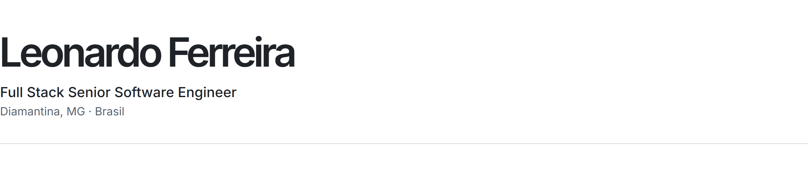
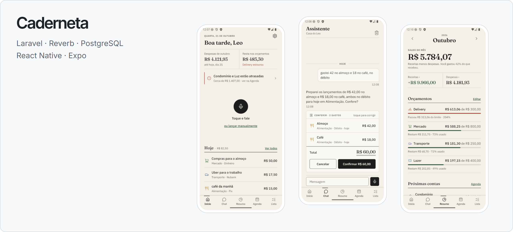
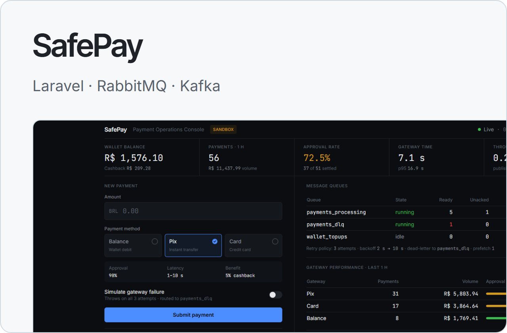
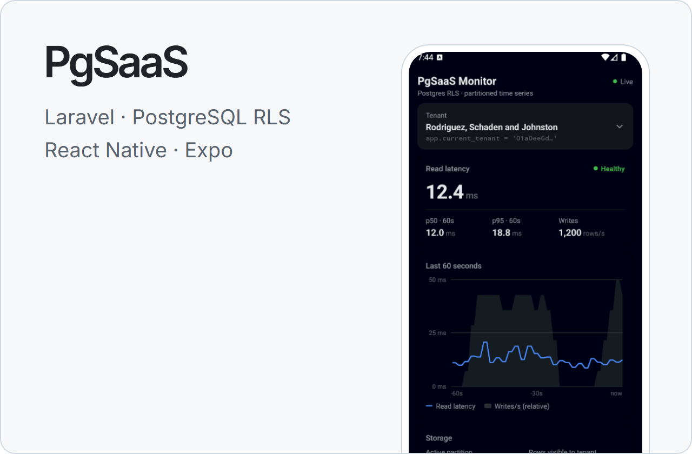

<picture>
  <source media="(prefers-color-scheme: dark)" srcset="./assets/cabecalho-escuro.png">
  
</picture>

[Português](./README.md) · English

I work in software development and currently lead the Web and Mobile area at the company where I work. Day to day, I work on desktop systems for gas stations, web applications, APIs, mobile apps and integrations with banks, loyalty programs and other partners.

## Projects

Here are some projects I build on my own and keep open source. In each repository I include instructions to run the project and explain the main technical decisions.

<a href="https://github.com/Leo-o-Nardo/caderneta">
  <picture>
    <source media="(prefers-color-scheme: dark)" srcset="./assets/caderneta-escuro.png">
    
  </picture>
</a>

**[Caderneta](https://github.com/Leo-o-Nardo/caderneta)**: an app to organize household finances using voice messages. You say what you spent and an AI agent turns it into an entry. The project uses Laravel on the back end, with queues and WebSockets, React Native for the app, and tests on both sides. It also has a layer that protects the data before sending it to the AI.

See also the [design guide](https://leo-o-nardo.github.io/caderneta/design-guide.html) and the [technical documentation](https://github.com/Leo-o-Nardo/caderneta/tree/main/docs/tecnico) (in Portuguese).

<a href="https://github.com/Leo-o-Nardo/SafePay"><picture><source media="(prefers-color-scheme: dark)" srcset="./assets/safepay-escuro.png"></picture></a>
<a href="https://github.com/Leo-o-Nardo/postgres-rls-multitenancy"><picture><source media="(prefers-color-scheme: dark)" srcset="./assets/pgsaas-escuro.png"></picture></a>

- **[SafePay](https://github.com/Leo-o-Nardo/SafePay)**: a payments project that simulates a microservices architecture. It works with RabbitMQ, retries, dead-letter queues, Kafka events and a console to follow operations in real time.
- **[PgSaaS](https://github.com/Leo-o-Nardo/postgres-rls-multitenancy)**: a project to study multi-tenancy with PostgreSQL, using RLS (Row Level Security) to isolate each customer's data. It also includes partitioned tables and an app to watch the database during load tests.

## Tools

PHP · Laravel · PostgreSQL · Redis · RabbitMQ · Kafka · Docker · TypeScript · React Native · Expo

## Contact

[Email](mailto:leonard.ofs351@gmail.com) · [LinkedIn](https://www.linkedin.com/in/leonardo-ferreira-de-souza/)
